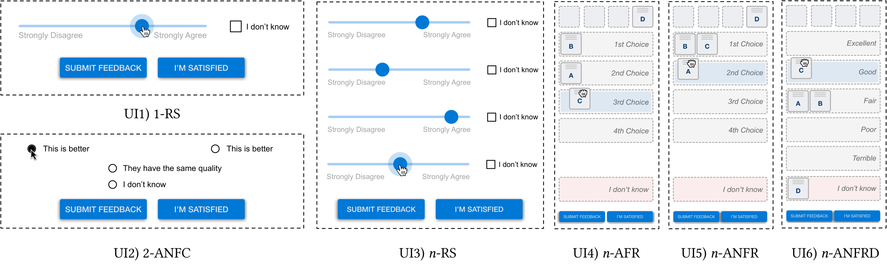

# Rethinking Opinion Measurement Interfaces for Human-in-the-Loop Optimization



**Rethinking Opinion Measurement Interfaces for Human-in-the-Loop Optimization** <br/>
**[Changkun Ou](https://changkun.de)**, **[Sven Mayer](https://sven-mayer.com)**, **[Daniel Buschek](https://daniel-buschek.de)**, and **[Andreas Butz](http://butz.org)** <br/>

This repository includes the paper, the collected dataset (anonymized), the
scripts that reproduce the reported results, and the source code of the system
used in the studies.

## Full Paper

The paper is available at [ou2026rethinking.pdf](./ou2026rethinking.pdf).
Its LaTeX source is in the [paper](./paper) folder.

Human-in-the-loop optimization presents choices to a human decision-maker and
queries their judgment to optimize system parameters iteratively. The paper
revisits the design space of the interfaces that measure this judgment and
compares six of them in a study (N=360) on text summarization and image color
enhancement:

| UI | Interface | Folder name |
|:---|:----------|:------------|
| UI1 | Single item Rating Scale (1-RS) | `pointwise` |
| UI2 | Two Alternative Non-Forced Choice (2-ANFC) | `pairwise` |
| UI3 | n-items Rating Scales (n-RS) | `listwise-rating` |
| UI4 | n-Alternative Forced Ranking (n-AFR) | `listwise-notie` |
| UI5 | n-Alternative Non-Forced Ranking (n-ANFR) | `listwise-cantie` |
| UI6 | n-Alternative Non-Forced Ranking with Distance (n-ANFRD) | `listwise-ranking` |

## Why Now

The central claim of this paper is that measuring a human preference is an
interface design problem before it is a modeling problem. What an optimizer
can learn is bounded by what the interface lets a person express. A single
rating scale, a pairwise choice, and a ranking anchored on an absolute scale
elicit different signals from the same person about the same options, and
the difference carries through to the optimization outcome. In our studies,
the interface that anchors relative rankings on an absolute scale (UI6)
reached significantly higher utility in the optimization loop than the
pairwise and the other listwise interfaces, and interfaces that let people
say "these are equal" or "I don't know" made indifference and incompleteness
visible as signals of their own, which a forced answer hides.

When the paper was written in 2022, this was a question for human-in-the-loop
optimization. Since then, learning from human preferences has become a
standard way to train and evaluate large models: reinforcement learning from
human feedback, preference-based fine-tuning, and model comparisons all rest
on ratings and pairwise judgments that people give through some interface.
How well those judgments capture what people actually prefer depends on how
the question is asked, which is the question this paper studied.

We first submitted the paper to CHI 2023 with one study (text summarization,
N=180), and ran a second study (image color enhancement, N=180) during the
revision period. A year later, we submitted the extended paper to ACM TOCHI.
By then, the first author was working full time in industry and had no time
to take the paper through the revision process. Four years after the paper
was written, the first author decided to open source the entire paper and
its results. Everything in this repository is published as is: the
manuscript is the last version of the paper, and the artifacts are the ones
used to produce it.

## Dataset

The dataset was collected with the system developed for this project. The
[analysis/processed](./analysis/processed) folder contains pre-computed data
frames for the statistical analysis. The raw data (every session of the 360
analyzed participants, including all options the optimizer presented) is too
large for a git repository and can be downloaded from the
[releases](https://github.com/changkun/rankui/releases) page. See
[analysis/README.md](./analysis/README.md) for the data layout and how the
data was anonymized.

## Scripts and Figures

The Python and R notebooks in the [analysis](./analysis) folder reproduce the
results reported in the paper:

| Paper section | Notebooks |
|:--------------|:----------|
| 5.5 Participants | `1.demographics` |
| 6.1 Decision time per iteration and per item | `2.decision_time_vis`, `2.decision_time_stats` |
| 6.1 Number of iterations and ranking interactions | `5.iterations`, `5.iteration_stats1`, `5.iteration_stats2` |
| 6.1 Expressing indifference and incompleteness | `3.preference_behavior`, `4.scales`, `4.scales_bayes` |
| 6.2 Objective quality of system outcomes | `6.outcomes1`, `6.outcomes_stats1` (text), `6.outcomes2`, `6.outcomes_stats2` (image) |
| 6.2 User feedback and optimizer learned utility | `7.direct_utility_vis`, `7.direct_utility_stats`, `7.latent_utility_vis`, `7.latent_utility_stats` |
| 6.3 Questionnaire results | `8.questionnaire_vis`, `8.questionnaire_stats`, `8.questionnaire_lmm` |
| Appendix A Benchmark of the Bayesian optimizers | [system/services/bosim](./system/services/bosim) |

The generated figures are in [analysis/figures](./analysis/figures).

## System

The study system consists of twelve frontend applications (six interfaces for
each of the two domains), a backend server written in Go, a Bayesian optimizer
service, and a text summarization service. For more information, see
[system/README.md](./system/README.md).

## Contribute

The easiest way to contribute is to provide feedback! We would love to hear what you think. Please write to [research@changkun.de](mailto:research[at]changkun.de) for closer communication.

## Licenses and Citation

Copyright &copy; 2023. [LMU Munich Media Informatics Group](https://www.medien.ifi.lmu.de). All rights reserved.

The [dataset](./analysis) itself (i.e., metadata, generated files, generated optimizer configurations, etc), available in [Creative Commons Public Domain Dedication (CC-0)](https://creativecommons.org/share-your-work/public-domain/cc0/), represented the results from consented anonymous participants and was collected by [Changkun Ou](https://changkun.de). The contained "source code" (i.e., Go, Python, R, JavaScript, etc) of this work is made available under the terms of [GNU GPLv3](./LICENSE) (by default). The [paper](./ou2026rethinking.pdf) and its [source](./paper) are available under [Creative Commons Attribution (CC BY 4.0)](https://creativecommons.org/licenses/by/4.0/).

The task materials are third-party content and remain under their original terms: the news articles are taken from the [CNN/DailyMail](https://huggingface.co/datasets/cnn_dailymail) dataset, and the photos from [Sequential Gallery](https://github.com/yuki-koyama/sequential-gallery).

If you find our research helpful, we would appreciate a citation via:

```bibtex
@misc{ou2026rethinking,
	title        = {Rethinking Opinion Measurement Interfaces for Human-in-the-Loop Optimization},
	author       = {Ou, Changkun and Mayer, Sven and Buschek, Daniel and Butz, Andreas},
	year         = 2026,
	howpublished = {\url{https://github.com/changkun/rankui}}
}
```
